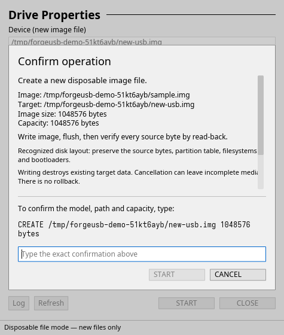

# ForgeUSB

A native Linux boot-media writer in Rust, with an Iced desktop app and a shared CLI engine. It writes raw disk/ISOHybrid images, prepares Windows UEFI installation media from ISO9660/UDF images or extracted trees, and creates partitioned FAT32/NTFS images. Writes require an exact reviewed confirmation and full source-byte read-back. This is an engineering build with [explicit release gates](docs/production-development.md), rather than a claim of complete Rufus parity.

**Physical writes erase the selected USB. No physical disk was overwritten during development.** Never run the GUI as root. Physical writes require a separately installed Polkit helper, an eligible unmounted USB with a stable identity, a reviewed plan, and exact typed confirmation. No device is automatically selected. Desktop admission is preliminary; the root helper must repeat authoritative system-wide checks before any physical write. The device layer rejects host/system storage, mounted partitions, active swap, device-mapper/RAID holders, uncertain backing topology and non-512-byte logical sectors.

## Screenshots

Compact desktop interface using a synthetic demo image. No target is selected.


Read-only operation review using synthetic demo paths in disposable-file mode. Writing remains disabled until the exact confirmation is entered; this capture did not start a write.



## Build and run

Rust stable >=1.88 and a C linker are required. On Arch/CachyOS install build prerequisites through your normal package manager; see [installation](docs/installation.md). The desktop uses Wayland or X11 and a software renderer.

```sh
cargo build --release --locked
./target/release/forgeusb-gui
./target/release/forgeusb list --json
./target/release/forgeusb inspect /absolute/path/linux.iso --json
./target/release/forgeusb check-dependencies
```

For redistributable artifacts, use `python3 packaging/build.py build --release --locked`.
This wrapper remaps personal source/cache paths in compiler diagnostics; ordinary
Cargo builds are development artifacts. Packaging scripts use the wrapper.

This host's inherited linker name `x86_64-linux-gnu-gcc` was absent. The project-local `.cargo/config.toml` therefore selects `/usr/bin/cc` and one build job. Initial validation also used the matching per-command override and `CARGO_PROFILE_DEV_DEBUG=0`. No global toolchain, Ghidra, or Codex configuration was changed. In Fish use `env NAME=value cargo ...` for optional environment overrides.

## Review, then write

Planning is read-only and produces the exact source SHA-256, identity/topology snapshot, target capacity, strategy, warnings and confirmation text. Partition table, firmware mode, filesystems, labels and embedded bootloaders are preserved from the image.

```sh
./target/release/forgeusb plan /absolute/path/linux.iso --device /dev/sdX --json > plan.json
./target/release/forgeusb write --plan plan.json
./target/release/forgeusb verify /absolute/path/linux.iso --device /dev/sdX
```

The write command prompts interactively. Noninteractive use requires BOTH the reviewed plan file and `--confirm 'EXACT confirmation FROM plan.json'`; there is no blanket `--yes` or system-disk override. A changed source/device invalidates the plan. Physical write privilege is obtained through fixed `/usr/bin/pkexec /usr/lib/forgeusb/forgeusb-helper write --plan-json --protocol-v2`. The helper revalidates the plan independently and only opens user-readable, user-owned source files with that user's filesystem credentials. See [device safety](docs/device-safety.md) and [threat model](docs/threat-model.md).

To exercise the complete write/verify path without USB hardware, choose a **new** output file:

```sh
./target/release/forgeusb plan /absolute/path/disk.img --device /absolute/path/NEW-test-copy.img --test-file --json > plan.json
./target/release/forgeusb write --plan plan.json
./target/release/forgeusb verify /absolute/path/disk.img --device /absolute/path/NEW-test-copy.img --test-file
```

Disposable-file mode never overwrites an existing file. The compact Rufus-style GUI exposes the same mode under advanced drive properties. SELECT or Ctrl+O opens a native file chooser; START or Ctrl+P opens the read-only review. Writing requires exact typed confirmation in that dialog. Esc dismisses or cancels. See [GUI details](docs/gui.md).

`--json` emits a JSON document for read-only queries and newline-delimited progress/completion events for write/verify. Preparation/formatting commands emit one final JSON report on stdout and progress
on stderr. Errors are JSON on stderr. Exit status: 0 success; 1 operation/safety/dependency failure; 2 invalid CLI syntax. Ctrl+C requests cancellation and currently returns operation failure (1). A partial write is not rolled back. Cancellation takes effect between I/O chunks and cannot interrupt a kernel I/O call already blocked.

## What is supported

- Live whole-disk/partition discovery, filesystem/mount information, stable identity checks, and periodic GUI hotplug refresh.
- Bounded ISO9660/UDF recognition, El Torito validation-header inspection, MBR/GPT primary metadata checks, SHA-256, disk/ISOHybrid strategy selection.
- Streaming raw writes with a 1 MiB buffer, exclusive kernel device claim, flush and complete source-length byte comparison.
- Windows UEFI media preparation: bounded ISO9660/UDF extraction, descriptor-based tree snapshots, WIM verification/splitting, MBR/GPT FAT32 construction and per-file SHA-256 read-back. The resulting image goes through the same reviewed USB write path. The GUI exposes both Windows modes.
- New-image FAT32 and NTFS formatting with MBR/GPT partition tables, filesystem diagnostics, partition read-back and atomic publication. Filesystem tools never receive a physical device.
- Stronger standalone GPT validation and bounded removal/read-back of recognized stale backup GPT metadata beyond the source range on a larger physical target.

Windows preparation has been validated with synthetic installer-shaped trees, real small WIM containers and an original EFI test program under OVMF. **Genuine Windows Setup has not been tested.** Windows BIOS/NTFS boot, UEFI:NTFS installation, generic Linux extraction, persistence, compressed writes and safe power-off remain unavailable. Unmount through your desktop before planning, and safely remove/reinsert after writing. Secure Boot depends on the source loader and firmware trust/revocation state. Read-back verifies storage bytes, not firmware compatibility or power-loss persistence. Most unused target space remains untouched; only recognized stale target-end GPT metadata is cleared separately. GPT is preserved at the source image's size, without relocation to a larger device's end. See the [compatibility matrix](docs/compatibility.md).

## Windows UEFI media and formatting

Preparation runs unprivileged and creates a new ordinary image file. Install the optional OS packages providing **7z/7zz, dosfstools, mtools and wimlib**; ForgeUSB does not install dependencies or download Windows/bootloader files. Allow disk space for the extracted snapshot, filesystem and final image. Scratch files are created beside the output, avoiding RAM-backed `/tmp` limits.

```sh
forgeusb prepare-windows /path/windows.iso --output /path/NEW-windows.img --scheme mbr --json
forgeusb plan /path/NEW-windows.img --device /dev/sdX --json > plan.json
forgeusb write --plan plan.json

forgeusb format-image --output /path/NEW-ntfs.img --filesystem ntfs --scheme gpt --capacity-mib 4096
```

Both Windows partition schemes target **UEFI**; MBR does not install BIOS boot code. Oversized `install.wim` is split automatically; oversized solid ESD and other oversized files are refused. NTFS formatting creates a blank data filesystem and adds no bootloader. Choose **Windows installer** in the GUI's Image option; START first prepares a private image in the user cache, then opens the USB review. Closing/cancelling preparation cannot start a USB write. [Windows details and limits](docs/windows.md).

## Tests and research

```sh
cargo fmt --all -- --check
cargo clippy --workspace --all-targets -- -D warnings
cargo test --workspace
cargo build --release
python3 tests/file-integration.py --cli target/release/forgeusb
python3 tests/media-integration.py --cli target/release/forgeusb --output test-output/NEW-media
python3 tests/boot-integration.py --cli target/release/forgeusb --output test-output/NEW-boot
```

All destructive integration fixtures are newly owned ordinary files. Loop/physical tests are not silently enabled. QEMU tests attach only an explicitly selected regular image, disable networking and use fresh OVMF NVRAM. [Validation results](docs/validation.md) distinguish synthetic layouts, virtual Linux startup and untested physical/Windows behavior. [Milestones](docs/milestones.md) records delivered functions and remaining engineering work.

Rufus v4.15 source and its matching official executable were investigated using REA 6.5.0 and Ghidra 12.1.4. [Research index](docs/reverse-engineering/README.md) links source architecture, diagrams, function mappings, binary evidence and limitations. Development references remain local under `references/` and are excluded from packages. [Dependency decisions](docs/dependencies.md), [license inventory](docs/dependency-licenses.json) and [third-party notices](THIRD_PARTY_NOTICES.md) document the supply chain.

## Packaging

Run `bash packaging/install.sh --system` as your desktop user to build and install with administrator authentication for the final copy. The application menu launcher and window include the ForgeUSB icon. `--user` installs desktop/CLI only; `--stage /tmp/forgeusb-NEW-stage --no-build` prepares a new disposable staging tree. See [installation and removal](docs/installation.md).

`make -f packaging/Makefile install DESTDIR=/tmp/forgeusb-stage` stages binaries, desktop entry, original icon, license texts and Polkit policy without privileged installation. A real `/usr` installation is a separate administrator step. `bash packaging/make-source-archive.sh` creates a deterministic source archive and an Arch PKGBUILD with the exact checksum. Debian/RPM recipes are starting points and have not been built in clean distribution containers. `bash packaging/make-portable.sh` builds a local portable directory archive for this host's glibc. A portable directory can run the GUI/CLI; physical writes still require the trusted system helper/policy. No online updates or telemetry are implemented.

GPL-3.0-or-later. Independent implementation; no upstream executable or bootloader is distributed with ForgeUSB.
