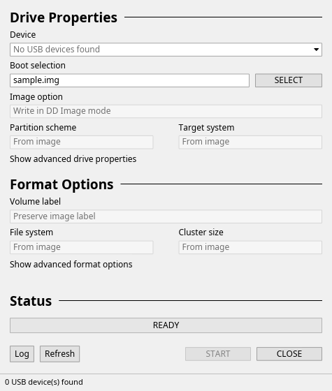

# Desktop application

ForgeUSB uses a compact, plain dialog based on Rufus's original control order:
**Drive Properties**, **Format Options**, **Status**, then **START / CLOSE**.
The default is a 475 × 560 light window with square controls, a gray background,
small system-style text, and no cards, banners or decorative branding. The
window can be resized; extra properties scroll while progress and actions stay
visible. Linux supplies the title bar; Noto Sans replaces Windows's Segoe UI.
The app remains an independent ForgeUSB implementation. Its original USB icon is
embedded for X11 and installed in the desktop icon theme; the Wayland app ID
and desktop launcher both use `forgeusb`.

The GUI uses Iced 0.13, its CPU renderer (`tiny-skia`) and a Tokio runtime. It
refuses UID 0. The privileged helper, device policy and streaming write engine
are shared with the CLI.

```sh
cargo run -p forgeusb-gui
cargo run -p forgeusb-gui -- --image /absolute/path/linux.iso
```

## Normal workflow

1. Select an eligible USB in **Device**. No physical device is automatically
   selected. Connect an unmounted USB and use **Refresh** if necessary.
2. Press **SELECT** and choose the source image. KDE's `kdialog` is preferred;
   `zenity` is the fallback. Source inspection and SHA-256 run automatically on a
   background worker. You can also paste an absolute path into **Boot selection**
   and press Enter. The GUI reports an actionable error if neither chooser is
   installed; manual path entry remains available.
3. Press **START**. This first builds a genuinely read-only plan and opens
   **Confirm operation**. Review the source, target, exact byte counts, write
   strategy and warnings, then type the engine's exact confirmation phrase.
4. Press **START** in the confirmation dialog to write, flush and read back the
   complete source range. **CANCEL** or Escape dismisses the review and revokes
   its plan. Dismissing the dialog never starts a write.




**Image option** reports DD mode. Partition scheme, target system, volume label,
filesystem and cluster size are read-only because the raw engine preserves the
source's layout and bootloader. They do not pretend to format or alter it.
Unsupported optical images are identified in the main form and cannot enable
Start. ISO extraction, Windows media creation and persistence remain unsupported.

## Extra controls and safety

**Show advanced drive properties** reveals protected-device reasons, selected
identity/partitions, source type/SHA-256 and **Use a disposable image file**.
Disposable mode creates a NEW ordinary file and refuses existing destinations.
It is also available through `--test-output /absolute/path/NEW-copy.img`.

**Show advanced format options** explains DD verification and exposes the
optional dark theme. Required full read-back verification cannot be disabled.
**Log** opens the latest 160 state/error messages. This is an in-memory execution
log, not persistent forensic logging. No telemetry is sent.

Device discovery refreshes every three seconds. A changed or disappeared target
revokes the plan and confirmation. The helper independently revalidates identity,
capacity, system storage and source descriptors immediately before writing.

The event loop polls worker progress every 100 ms. While writing, CLOSE becomes
CANCEL. Window close requests cancellation and waits for the engine/helper to stop
before exit. Interruption can leave incomplete media; there is no rollback.
Closing while the native chooser is open kills and reaps the owned dialog process
before exit. The chooser has a five-minute timeout and never runs through a shell.

Keyboard: Ctrl+O opens SELECT; Enter analyzes a typed source path; Alt+Up/Down
explicitly cycle eligible targets; Alt+F toggles disposable mode; Ctrl+P opens the
read-only review; F8 opens the review or starts an already exactly confirmed plan;
Escape cancels/dismisses; Ctrl+R refreshes; Alt+L toggles the log; Alt+A toggles
advanced drive properties; Alt+T changes theme. Tab/Shift+Tab move focus. Full
screen-reader and cross-desktop file-dialog accessibility acceptance is pending.

## GUI validation

`--smoke-test` runs the actual event loop for ten seconds and never permits Start.
It prints a bounded final state record so the harness verifies source analysis,
confirmation state and the absence of a running operation. Private-Xvfb tests use
owned fixture paths and never select or plan against a physical device.

```sh
python3 tests/gui-smoke.py --binary target/release/forgeusb-gui \
  --source test-output/bios-source.img --preview --screenshot \
  --output-dir test-output/gui-compact-preview
# Optional: real kdialog/zenity source selection (requires that system tool).
python3 tests/gui-smoke.py --binary target/release/forgeusb-gui \
  --source test-output/bios-source.img --browse --preview --screenshot \
  --output-dir test-output/gui-compact-picker
# Normal physical-device selector, with no selection and no physical planning.
python3 tests/gui-smoke.py --binary target/release/forgeusb-gui \
  --source test-output/bios-source.img --device-mode --screenshot \
  --output-dir test-output/gui-compact-main
```

See [UI validation](ui-validation-results.json) and [visual comparison](../design-qa.md)
for the 2026-10-17 rework. Physical writes and the Polkit authorization dialog were
not exercised by these GUI tests.
