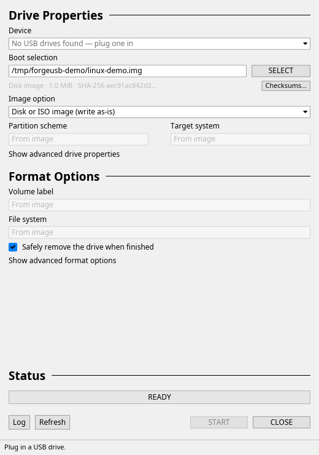
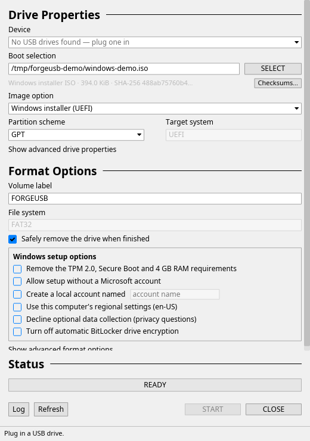
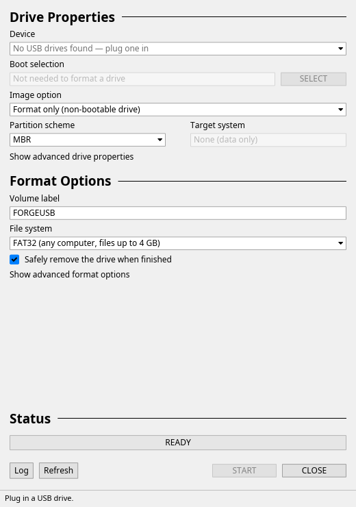
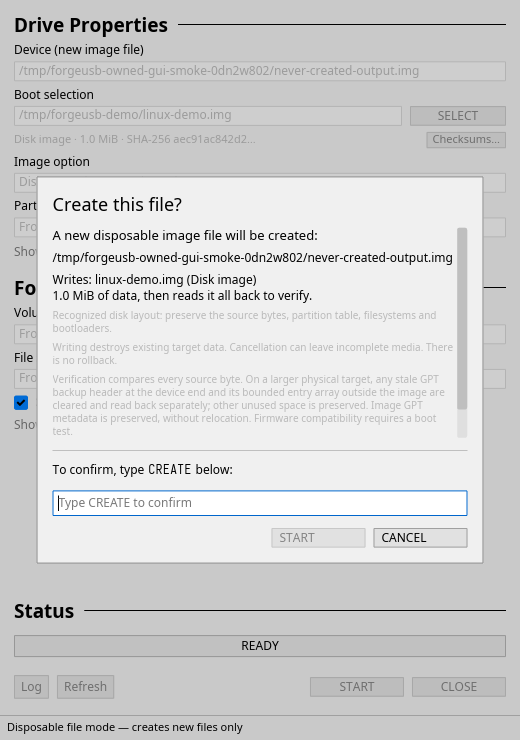

# Desktop application

ForgeUSB uses a compact, plain dialog based on Rufus's original control order:
**Drive Properties**, **Format Options**, **Status**, then **START / CLOSE**.
A one-line hint in the status bar always says what to do next ("Plug in a USB
drive", "Choose an image with SELECT, or drop a file on this window", "Press
START…"). Nothing is erased until you have reviewed the drive and typed its name.

The default is a 520 × 740 light window with square controls, a gray background,
small system-style text, and no cards, banners or decorative branding. The
window can be resized; extra properties scroll while progress and actions stay
visible. Linux supplies the title bar; Noto Sans replaces Windows's Segoe UI.
The app remains an independent ForgeUSB implementation. Its original USB icon is
embedded for X11 and installed in the desktop icon theme; the Wayland app ID
and desktop launcher both use `forgeusb`.

The GUI uses Iced 0.13, its CPU renderer (`tiny-skia`) and a Tokio runtime. It
refuses UID 0. The privileged helper, device policy and streaming write engine
are shared with the CLI.

```sh
cargo run -p forgeusb-gui
cargo run -p forgeusb-gui -- --image /absolute/path/linux.iso
cargo run -p forgeusb-gui -- --mode format
```

## Normal workflow

1. Choose the USB drive in **Device**. Only USB drives are listed and none is
   selected automatically. A drive whose partitions are mounted is listed as
   "(mounted)" with its partition labels and an **Unmount** button; ForgeUSB
   unmounts it through UDisks2 in your desktop session. Internal disks, SD card
   readers and other refused devices are never offered (see advanced
   properties for the reason).
2. Press **SELECT**, or drop a file on the window. The image is analyzed
   automatically: type, size and SHA-256. ForgeUSB picks the **Image option**:
   - *Disk or ISO image* writes vendor USB images and hybrid ISOs exactly as they
     are. gzip, xz, zstd, bzip2 and single-file zip images are expanded in your
     cache first, unprivileged.
   - *Windows installer* is chosen automatically for Windows ISOs. It builds a
     verified FAT32 installer sized to the drive (MBR or GPT, both UEFI).
   - *Format only* erases the drive and creates an empty FAT32, exFAT, NTFS or
     ext4 file system with your volume label. No image is needed.
3. Press **START**. Preparation (decompressing, building Windows media or
   formatting) happens in a private file in `$XDG_CACHE_HOME/forgeusb` and never
   touches the drive. Prepared images are sparse: only their data, plus the first
   and last 2 MiB, are written and verified, so formatting a large drive is fast.
4. The **Erase this drive?** dialog lists the drive, its size and every partition
   and label that will be erased, what will be written, and any Windows setup
   options. Type the drive's short name (for example `sda`; `CREATE` for a
   disposable file) and press **START**. The engine still checks its exact
   identity-bound confirmation, and the helper revalidates everything.
5. Progress shows speed and time remaining. After the read-back verification
   passes, the drive is safely powered off when **Safely remove the drive when
   finished** is ticked (the default), so it can be unplugged.

**Checksums…** beside the analyzed image shows MD5, SHA-1, SHA-256 and SHA-512.
A published checksum found beside the file (`NAME.sha256`, `SHA256SUMS`,
`sha256sum.txt` and similar) is filled in and compared automatically; you can
also paste one.

Public screenshots use synthetic demo files and generic temporary paths; personal directories are excluded.






In *Disk or ISO image* mode, partition scheme, target system, volume label and
file system show "From image": the raw engine preserves the image's layout and
bootloader. Plain optical ISOs without a USB boot layout are identified in the
main form and cannot enable START.

## Windows setup options

In *Windows installer* mode, an options box can add an `autounattend.xml` to the
media (only when at least one option is ticked; a source that already has one is
refused rather than overwritten):

- remove the TPM 2.0, Secure Boot and 4 GB RAM requirements;
- allow setup without a Microsoft account;
- create a local account with a name you choose (Windows asks for its password
  at first sign-in; no password is stored on the media);
- use this computer's regional settings (from `LANG`);
- decline optional data-collection questions;
- turn off automatic BitLocker device encryption.

The choices and the volume label are listed again in the confirmation dialog.
Windows Setup itself is not tested by ForgeUSB; see [Windows media](windows.md).

## Extra controls and safety

**Show advanced drive properties** reveals protected-device reasons, the selected
drive's identity, the full SHA-256, image notes and **Use a disposable image
file**. Disposable mode creates a NEW ordinary file and refuses existing
destinations. It is also available through `--test-output /absolute/path/NEW-copy.img`.

**Show advanced format options** explains what each mode does and exposes the
dark theme. Full read-back verification cannot be disabled. **Log** opens the
latest 160 state/error messages. This is an in-memory execution log, not
persistent forensic logging. No telemetry is sent.

Settings are remembered in `$XDG_CONFIG_HOME/forgeusb/settings.json`: theme,
safe-removal choice, partition scheme, file system and Windows options. Device
choice, source image and confirmations are never remembered.

Device discovery refreshes every three seconds. A changed or disappeared target
revokes the plan and confirmation; prepared media is rebuilt when the target's
size changes. The helper independently revalidates identity, capacity, system
storage and source descriptors immediately before writing.

The event loop polls worker progress every 100 ms. While writing, CLOSE becomes
CANCEL. Window close requests cancellation and waits for the engine/helper to stop
before exit. Interruption can leave incomplete media; there is no rollback.
Closing while the native chooser is open kills and reaps the owned dialog process
before exit. The chooser has a five-minute timeout and never runs through a shell.

Keyboard: Ctrl+O opens SELECT; Alt+Up/Down explicitly cycle drives; Alt+F
toggles disposable mode; Ctrl+P starts (prepares and opens the review); F8 opens
the review or starts an already confirmed plan; Escape cancels/dismisses; Ctrl+R
refreshes; Alt+L toggles the log; Alt+A toggles advanced drive properties; Alt+T
changes theme. Tab/Shift+Tab move focus. Full screen-reader and cross-desktop
file-dialog accessibility acceptance is pending.

`--mode raw|windows-mbr|windows-gpt|format` selects the Image option at launch.

## GUI validation

`--smoke-test` runs the actual event loop for ten seconds and never permits Start.
It prints a bounded final state record so the harness verifies source analysis,
confirmation state and the absence of a running operation. Private-Xvfb tests use
owned fixture paths and never select or plan against a physical device.

```sh
python3 tests/gui-smoke.py --binary target/release/forgeusb-gui \
  --source test-output/bios-source.img --preview --screenshot \
  --output-dir test-output/gui-compact-preview
# Optional: real kdialog/zenity source selection (requires that system tool).
python3 tests/gui-smoke.py --binary target/release/forgeusb-gui \
  --source test-output/bios-source.img --browse --preview --screenshot \
  --output-dir test-output/gui-compact-picker
# Normal physical-device selector, with no selection and no physical planning.
python3 tests/gui-smoke.py --binary target/release/forgeusb-gui \
  --source test-output/bios-source.img --device-mode --screenshot \
  --output-dir test-output/gui-compact-main
```

See [UI validation](ui-validation-results.json) and [visual comparison](../design-qa.md)
for the 2026-10-17 rework. Physical writes and the Polkit authorization dialog were
not exercised by these GUI tests.
