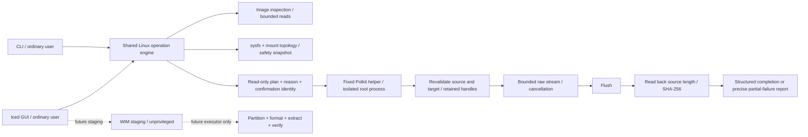

# Linux implementation architecture

ForgeUSB 0.1 is a vertical slice with explicit compatibility limits. It preserves raw image layouts, rather than translating Windows APIs or promising every Rufus strategy.

Crate contracts:

- `forgeusb-core`: shared cancellation, state/progress and byte-capacity policy.
- `forgeusb-device`: live device inventory and system-storage safety. Device display order never grants selection permission.
- `forgeusb-image`: structural metadata, image size and digests. Extension alone cannot choose a strategy.
- `forgeusb-linux`: shared operation orchestration and bounded raw I/O used by both clients.
- `forgeusb-verify`: readback comparison/digest coverage for the written prefix.
- `forgeusb-privileged`: fixed helper entry point; all arguments are untrusted and independently checked.
- `forgeusb-partition`: pure MBR/GPT UEFI FAT32 layout plan. It computes 128-entry GPT reservation for 512/4096 sectors, 1 MiB alignment, minimum 260 MiB FAT32 policy, MBR range and checked bounds. No table is written.
- `forgeusb-filesystem`: exact FAT32 file limit (4,294,967,295 bytes) and conservative FAT/Windows filename policy. No filesystem is created.
- `forgeusb-boot`: executable raw strategy and non-executable Windows strategy descriptions; compressed/plain ISO/firmware override cases fail explicitly.
- `forgeusb-windows`: bounded quiescent-tree metadata and PE-machine validation, plus optional standalone WIM split stage. Neither creates bootable installation media.

The pure boot policy module is an extension contract; clients may currently expose narrower options through their engine's raw strategy. It must not be used to label a planned Windows method as executable.

## Dependency decisions

Sysfs plus util-linux JSON avoids a mandatory libudev build dependency for the first slice. A polling hotplug refresh can discover changes without performing device mutation. Kernel major/minor identity and sysfs ancestry are more useful safety evidence than a user-visible `/dev/sdX` name. Where topology is incomplete, refuse rather than guess. UDisks2 can eventually supply a user-session-aware unmount/poweroff boundary; support is not implied merely by detecting its presence.

Polkit elevation applies only to the installed fixed helper. The GUI must stay unprivileged. Policy asks administrator authentication each time (`auth_admin`, not cached `_keep`) and denies inactive/remote session use. It is not a substitute for revalidation inside the helper, and the helper is not setuid.

Do not reimplement FAT32/NTFS formatting or WIM resource manipulation for an initial release. Mature utilities are candidates only behind typed operations with fixed absolute paths and bounded process lifetime. The optional WIM stage uses `/usr/bin/wimlib-imagex`, a fresh private output directory, a 3800 MiB part target, no shell, a cleared environment and null subprocess streams to bound retained output. It rejects root execution and validates output file types/magic/sizes. Integrity-table validation depends on the input containing one; `--check` does not establish Microsoft provenance. Input staging must be quiescent and caller-owned; this stage is not an adversarial privilege boundary.

Iced provides a Rust UI and shared typed state; tiny-skia avoids requiring a Vulkan-capable GPU. Async UI tasks/threads keep I/O outside event dispatch. Tokio is pulled through Iced's executor; core raw I/O does not need an async runtime. SHA-256 identifies content, not the publisher. Serde is the JSON contract. Libc supplies the few Linux descriptor/identity operations. A tracing/logging expansion can follow once error/progress contracts are stable; do not claim tracing is integrated if it is absent from the lockfile.

## Future extraction strategies

1. Windows UEFI FAT32: validate architecture-specific fallback EFI, boot.wim and install.wim/esd/swm; compute allocation overhead; create aligned MBR/GPT FAT32 with audited tools; safely extract without path traversal or symlinks; split only supported WIMs; check every final file's size, digest and boot structure. Large non-WIM files or oversized unsplittable resources must fail. Boot with an authorized Windows ISO before advertising support.
2. Windows NTFS plus UEFI:NTFS: pin exact partition-image digest and provenance, inventory PE machine types, license/driver sources and signatures, and current revocation state. Implement the special tested partition layout, not the generic ESP layout. No automatic downgrade of Secure Boot settings.
3. Linux extraction: opt-in distribution/version adapters with fixture-based config changes and matching GRUB/Syslinux modules. Plain El Torito optical boot is not sufficient evidence for a USB boot method.
4. Persistence: separate ext partition and distribution-specific labels/config; prove persistence survives reboot. Never append a partition based solely on a `casper` filename.
5. Compressed images: detect compression structurally, limit expanded length to plan capacity, check decoder errors and source mutation, propagate cancellation, and verify decompressed bytes. Staging decompression is required until then.

Each executor must return distinct write, flush, verification and boot-test evidence. A successful write is not a boot test. Buffer flushing does not make writes transactional and cannot prove that defective hardware retained data after power loss.
