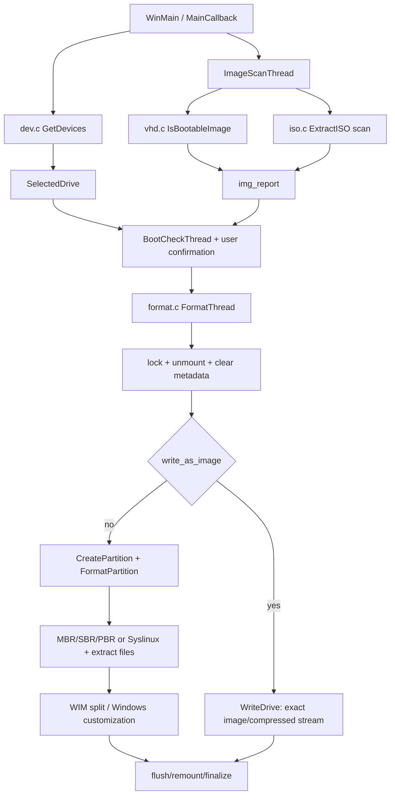

# Rufus source architecture and ForgeUSB mapping

Study date: 2026-10-16. This is a focused source investigation, not a claim of complete Rufus parity. Binary evidence is recorded separately in this directory. Static source observations do not establish execution, physical-device success or boot compatibility.

## Reference identity and provenance

| Project | Exact studied revision | License observation |
|---|---|---|
| [Rufus](https://github.com/pbatard/rufus/tree/6d8fbf98305ff37eb531c45cbd6ff44563c53917) | `v4.15`, `6d8fbf98305ff37eb531c45cbd6ff44563c53917` | `LICENSE.txt` GPLv3 text; `src/rufus.c:6-8` GPL-3.0-or-later grant |
| [WoeUSB](https://github.com/WoeUSB/WoeUSB/tree/4c1f1c9718218c5a22d945a72ed78a2b4a4977eb) | `4c1f1c9718218c5a22d945a72ed78a2b4a4977eb` | `sbin/woeusb:9` GPL-3.0-or-later; documentation/assets have additional `LICENSES/` notices |
| [WoeUSB-ng](https://github.com/WoeUSB/WoeUSB-ng/tree/cc52ffc6aedad12540c2315c9101e4a4b919d4be) | `cc52ffc6aedad12540c2315c9101e4a4b919d4be` | `COPYING` GPLv3; preserve per-file notices if reusing code |
| [UEFI:NTFS](https://github.com/pbatard/uefi-ntfs/tree/e7b9a094fa7e8db5b646f70dbf44eedb9075c10d) | `e7b9a094fa7e8db5b646f70dbf44eedb9075c10d` | `boot.c:6-8` GPL-2.0-or-later; drivers have their own licenses |

Cloned from the named official upstream repositories over HTTPS. See `reference-lock.json`. Reference trees and executables are development inputs ignored by Git and excluded from release packaging. The official executable provenance and analysis identity belong in the binary evidence report; source tag identity alone is not a byte-for-byte reproducible-build attestation.

Read: README, configure.ac, src/Makefile.am, SECURITY.md, license notices, and the modules below. Rufus SECURITY.md directs confidential vulnerability reporting to the upstream maintainer; it is not an implementation specification. [Upstream FAQ](https://github.com/pbatard/rufus/wiki/FAQ) and [security design discussion](https://github.com/pbatard/rufus/wiki/Security) provide context on ISO/DD choices and defenses. These live wiki pages are contextual sources, not pinned evidence for the v4.15 binary.

## Complete tracked-tree map

`rufus-v4.15-tracked-files.txt` exports every path from `git ls-tree -r --name-only HEAD`, including vendor trees and resources. `tree-counts.json` groups that inventory. Principal areas:

| Area | Responsibility |
|---|---|
| root `configure.ac`, `Makefile*`, `.mingw/`, `rufus.sln`, `.vs/` | MinGW/autotools and Visual Studio builds; `configure.ac:1` declares 4.15 |
| `.github/` | CI/repository metadata |
| `src/rufus.c`, `ui*`, `stdlg.c`, `darkmode*`, `icon.c`, localization files | Windows entry point, event dispatch, selections, progress and dialogs |
| `src/dev.c`, `drive.c`, `smart.c`, `hdd_vs_ufd.h` | Hardware discovery, device classification, partition/volume operations and storage metadata |
| `src/format.c`, `format_fat32.c`, `format_ext.c`, `badblocks.c` | Destructive workflow, raw I/O, formatters and destructive media tests |
| `src/iso.c`, `vhd.c`, `wue.c` | ISO/UDF discovery and extraction, disk/compressed image and WIM operations, Windows customization |
| `src/syslinux*`, `ms-sys/`, `dos*` | Syslinux installation, MBR/PBR code and DOS support |
| `src/hash.c`, `pki.c`, `net.c`, `process.c` | Digests, boot revocation/signature inspection, network and process utilities |
| `src/bled/`, `ext2fs/`, `libcdio/`, `wimlib/`, `getopt/`, `msvc-missing/` | Embedded compression, filesystem/image parsers and portability libraries |
| `res/` | Firmware/bootloader assets, DOS files, icons, localization, app resources; each asset needs its own licensing assessment |

There is **no `src/wim.c` or `src/partition.c` in this revision**. WIM wrappers are in `vhd.c`; partition creation is in `drive.c`.

## Entry points, state and threading

`src/rufus.c:3354-3356` defines `WinMain`, which initializes the application and creates the main dialog at `:3879`. `MainCallback` at `:2288` dispatches Windows messages. Selection-triggered scanning starts `ImageScanThread` at `:2664`; boot compatibility checks start `BootCheckThread` at `:2704`; hashing starts `HashThread` at `:2729`; confirmed formatting starts `FormatThread` at `:3145`.

The application is organized around shared C state rather than isolated request objects. `RUFUS_DRIVE_INFO` in `src/drive.h:340-364` holds geometry, partition offsets/sizes, filesystem and cluster choices. `RUFUS_IMG_REPORT` in `src/rufus.h:432-481` accumulates labels, projected size, image format, EFI architecture bits, Windows install paths, large-file flags, Syslinux/GRUB information and persistence hints. `ErrorStatus` in `src/format.c:68` is shared with callbacks and cancellation checks. UI updates use Windows messaging; background workers handle long operations.

ForgeUSB instead makes plans and device identity snapshots explicit, runs the shared engine outside the GUI event loop, emits structured progress, and uses an atomic cancellation token. A plan is descriptive; it never grants permission to write later without revalidation.

## Mechanism ledger

All source paths below refer to the pinned Rufus commit. The binary column explicitly distinguishes required follow-up from verified source facts; see the separate binary ledger for actual REA Evidence IDs. Imports alone cannot map a particular function body.

| Mechanism and source observation | Source anchor | Binary evidence scope | Windows dependency | ForgeUSB/Linux implementation and safety constraints |
|---|---|---|---|---|
| Enumerates USB/UASP and some card-reader/storage enumerators, not only removable-bit disks | `src/dev.c:444-530`, `:635-709` | Import corroboration can show SetupAPI/CM APIs; hardware enumeration was not executed on Windows | SetupDi, Configuration Manager, USB hub IOCTLs | Read sysfs/udev and mount topology; USB attachment and removable bit are separate evidence. Never infer safety solely from the removable bit |
| Queries geometry and partition layouts | `src/drive.c:1391-1410`, `:1872-2053` | PE imports may corroborate `DeviceIoControl`; geometry results require runtime | `IOCTL_DISK_GET_DRIVE_GEOMETRY_EX`, `IOCTL_DISK_GET_DRIVE_LAYOUT_EX` | Linux sysfs sector counts, `BLKGETSIZE64`, sector size, parent/slave topology and opened-fd major/minor identity |
| Opens physical/volume handles, retries access, attempts locks; can relax sharing after failures | `src/drive.c:138-215` | Decompiled body can distinguish retry/sharing paths; no runtime lock observation | `CreateFile`, `FSCTL_LOCK_VOLUME`, `FSCTL_ALLOW_EXTENDED_DASD_IO` | Exclusive block open, retained file descriptor, never relax safety after a failed lock; mounted or held storage must be rejected |
| ISO scan and extraction share a code path; UDF is tried first, ISO9660 follows, Joliet/Rock Ridge policies are explicit | `src/iso.c:1222-1356`, recursive extraction `:648`, `:802` | Calls/strings support parser presence; they do not prove an input was accepted | Embedded libcdio, Windows file APIs | Structural bounded parser for current inspection; filesystem extraction is gated until a safe mature parser and per-distribution boot strategy are integrated |
| Accumulates GRUB/Syslinux, EFI and Windows-file capabilities while scanning | `src/iso.c:249-480`, `:1083`, `:1191`; `src/rufus.h:432-481` | Selected callsites can be examined; symbol labels without addresses are not a binary proof | Image parsers and report flags | Capability-driven selection with explanations; a found filename is insufficient for authenticated bootability |
| Recognizes compressed/disk image structures and Windows WIM magic | `src/vhd.c:80-207` | Parser constants/branches may corroborate source; no decompression runtime proof | bled, Virtual Disk API for some formats | Raw images first; compressed writes are refused until decompressed-size bounds and decoder cancellation are enforced |
| MBR/GPT creation sets offsets/types; default first offset is 1 MiB, with compatibility exceptions | `src/drive.c:2277-2330`, `:2435-2575` | `DeviceIoControl` imports only corroborate API family; partition writes not executed | CreateDisk/layout IOCTLs, GUID creation | Pure checked planner; eventual executor should use audited libfdisk/sfdisk with explicit sector units and independently validate results |
| FAT32, NTFS/exFAT and ext formats use different backends | `src/format.c:665-682` | Formatter imports/resources do not prove a formatted image | fmifs/VDS; bundled FAT32/ext implementations | Keep filesystem limits in pure code. Future `mkfs.fat`, `mkntfs`, `mkfs.exfat`, `mke2fs` invocations need absolute executable paths and constrained arguments |
| Installs MBR, secondary stage and partition boot records; Syslinux is selected separately | `src/format.c:760`, `:900`, `:992`, `:1824-1911`; `src/syslinux.c` | Selected bootloader call graph requires binary analysis; no firmware execution claim | ms-sys, embedded Syslinux, physical/logical handles | Raw mode preserves source boot code; GRUB/Syslinux extraction support is deferred rather than installing arbitrary versions |
| WIM extraction, splitting and applying use wimlib; split target is 4094 MiB with fsync | `src/vhd.c:302-379`, especially `:339-357` | WIM code/string presence does not prove successful split | Embedded wimlib wrappers | Unprivileged staged `/usr/bin/wimlib-imagex split ... 3800 --check`; check every output against 4 GiB-1 because a single resource can exceed the requested part size |
| Handles Windows setup customization and Windows To Go | `src/wue.c:108`, `:531`, `:982`, `:1110`; `src/format.c:1970-2010` | Scope is source evidence unless a selected body is mapped | Unattend XML, registry/WIM modification, bcdboot | Windows filesystem media executor/To Go/customizations are not implemented; never silently treat a Windows ISO as a USB disk image |
| Persistence adjusts partitioning and distribution-specific config | `src/drive.c:2376-2405`, `src/iso.c:482` | No persistence runtime/boot result | ext formatter and distro config patching | Deferred; requires distribution/version fixtures and actual persistence reboot tests |
| Cancellation and errors propagate through shared status and callbacks, writes retry, finalization remounts/flushes | `src/format.c:1092-1443`, `:1445`, `:2012-2048`; `src/drive.c:2055-2088` | Windows failure/cancel behavior not executed | Win32 asynchronous I/O, `FlushFileBuffers`, mount management | Bounded streaming, explicit cancellation boundaries, sync errors reported, raw readback. Interruption leaves incomplete media; no rollback claim |
| Bad-block test deliberately writes patterns | `src/badblocks.c:329`, `:367`, `:389`, `:569` | Static only | Raw drive I/O/timers | Not exposed; never run automatically. It would require a separately confirmed destructive operation |
| Secure Boot checks include SBAT, dbx, SVN and certificates | `src/hash.c:2177-2450`, `src/pki.c` | Static branches/constants only unless separately mapped | WinTrust/Crypt32 and maintained revocation data | No universal Secure Boot claim; preserve vendor boot assets in raw mode, report verification limits; no bootloader download/install yet |

## Libraries and build dependencies

`src/Makefile.am:1-8,20-27` lists bundled bled, ext2fs, ms-sys, Syslinux libfat/libinstaller/win, libcdio ISO9660/UDF/driver, and wimlib. Windows links include COM/GDI/common controls/NTDLL and delayed-loading wrappers for crypt32, dwmapi, setupapi, uxtheme, version, virtdisk, wininet and wintrust. The build comments describe DLL search-path risk as the reason for selected delayed-loading wrappers. `configure.ac:15-18` sets Windows API level and PE DEP/ASLR flags. These are source build settings, not independent proof of the analyzed executable's mitigation flags.

## Related-project findings

WoeUSB demonstrates the Linux utility pipeline: partition, format, mount, copy, bootloader installation and optional WIM splitting (`sbin/woeusb:1250-1368,1716-1733,1881-1930`). Its embedded UEFI:NTFS revision is pinned in the script (`:21`), but its installation path downloads a prebuilt partition image. ForgeUSB deliberately does not reuse a mutable network download at write time.

WoeUSB-ng's Python rewrite calls partition and formatting tools (`src/WoeUSB/core.py:260-326`), uses a GRUB post-MBR gap (`:298-300`), and retrieves UEFI:NTFS from a mutable Rufus master URL (`:362-383`). These are useful compatibility clues, not a security model to copy. Its README's advertised native UEFI support is FAT-limited (`README.md:17-20`) and is narrower than some code paths suggest.

UEFI:NTFS `boot.c:246-431` finds the filesystem driver and the NTFS/exFAT partition on the same device and starts the driver; `:527-551` loads and starts the fallback EFI loader. Firmware `LoadImage` enforces its active signature policy. A signature's existence is not proof the target firmware currently trusts it. Rufus's special GPT UEFI:NTFS type choice (`src/drive.c:2478-2486`) is a Windows installer compatibility workaround, so a generic ESP planner must not be presented as a faithful UEFI:NTFS layout implementation.

## Remaining investigation

The complete source tree is inventoried; detailed code review covers the important paths above. Specialized DOS/ReactOS/Windows To Go, all distro config patches, extended filesystems, image-save formats and every bundled parser have not been exhaustively reviewed. Binary/source mappings must remain bounded by actual retained Evidence IDs. Windows runtime execution and cross-firmware/hardware compatibility remain unverified.

## Upstream design discussions reviewed

The [Rufus FAQ discussion of DD versus ISO mode](https://github.com/pbatard/rufus/wiki/FAQ#why-doesnt-rufus-recommend-dd-mode-over-iso-mode-for-isohybrid-images-surely-dd-is-better) explains that extraction enables a writable general-purpose filesystem, selected partition/firmware behavior and extra boot-time validation, while raw mode preserves the vendor image but inherits its layout. ForgeUSB selects raw first for a bounded initial implementation, not because every image is best served by it. The [DLL-loading security discussion](https://github.com/pbatard/rufus/wiki/Security) and [issue 2272](https://github.com/pbatard/rufus/issues/2272) contextualize the delay-load build rules; the latter issue concerns x86 Windows ISO parsing crashes, and the Makefile itself links it to the relevant library workaround. These discussions do not replace pinned code evidence.
