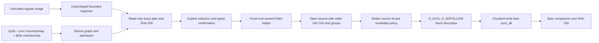

# Threat model and safety boundary

## Assets and trust boundaries

The principal asset is every host storage device the user did **not** choose. Secondary assets are the selected USB's truthful verification result, readable source contents, source-image integrity, and the unprivileged desktop session. ISO metadata, filesystem names, source paths, serialized plans, external-process output and hotplug events are untrusted. Device serial numbers are useful continuity evidence, not cryptographic identity.

The entire GUI never runs as root. The fixed installed helper only accepts bounded one-line JSON raw-write plans for block devices. Test-file mode is rejected at that boundary. It obtains the caller from PKEXEC_UID, resolves that account, applies/checks its filesystem UID/GID/supplementary groups for source opening, requires a caller-owned regular source, restores/checks root credentials, and retains the source descriptor through inspection, writing and read-back. It does not trust plan eligibility, reported source size, strategy, confirmation or device identity without independently rebuilding them from current facts. No shell is used. Physical writes require Polkit administrator authentication; the policy does not cache authorization or permit an arbitrary executable.

## Threats, controls and residual risks

| Threat | Implemented control | Residual/test boundary |
|---|---|---|
| Host disk mistakenly selected | No default selection; USB-only preliminary desktop admission; authoritative root helper admission checks all mounts/swap and graph-connected partition/slave/holder/Btrfs members protected; unknown active sources refuse admission | Physical scenarios not accepted/tested on hardware. Exotic remote/FUSE/private namespace backing fails closed rather than being guessed |
| `/dev` symlink/path swap | Exact whole-device path, no symlinks, fstat major/minor, sysfs identity/topology, model/vendor/capacity/logical sector rechecks, O_EXCL claim and flock held until read-back completes | Device identities can be spoofed by malicious hardware; a determined privileged raw writer cannot be excluded by advisory flock |
| Mount/swap appears between plan and write | Fresh graph/mount snapshot before open, kernel block O_EXCL claim, revalidation after opening | Kernel/driver semantics assumed; hostile root or faulty kernel out of scope |
| USB replaced in same device slot | Serial/WWID, canonical sysfs topology, dev_t, capacity, sector size and display identity must match; true USB serial comes only from nearest device, never hubs | A serial is not authentication; duplicated USB identifiers refuse writes when observed |
| 4Kn geometry yields verified unbootable bytes | Refuse non-512 logical sectors until geometry-aware support is implemented | Restrictive by design; pure layout planner's 4K arithmetic is not a physical writer capability |
| Source path changed across privilege boundary | Caller-credential source open retained as file descriptor; independent hash/metadata/stamp checks; same fd throughout | Source concurrently overwritten may partially alter target before mismatch is detected. The result is failure and incomplete target, not rollback |
| Malformed ISO/GPT metadata or resource exhaustion | Checked bounds/arithmetic; bounded descriptor scan, ISO root size, GPT table/entry size and record validation; fixed streaming buffers | Inspector is intentionally limited, not a complete ISO/UDF validator. Primary GPT integrity only; no backup-GPT/overlap repair. Additional fuzzing remains useful |
| Arbitrary privileged commands | Fixed pkexec/helper paths, root-owned non-writable/non-symlink path checks, fixed helper mode, no shell; WIM staging is unprivileged with fixed tool and argument vector | A compromised trusted system utility/OS is out of scope; system update policy belongs to administrator |
| Forged helper result | CLI/GUI parse bounded event lines and require verified flag, exact planned byte count/hash and successful process exit | Root helper installation/Polkit end-to-end was not exercised in development; no helper installed without authorization |
| Client disappears/cancellation | Control input EOF, malformed input or cancellation triggers Cancellation; 1 MiB I/O boundaries, partial flush attempted on errors | Blocked kernel I/O or SIGKILL/power loss can prevent cleanup. Cancellation may leave an incomplete target |
| Short reads/writes, truncation, unplug, full target | read_exact/write_all, preflight capacity, metadata/content stability checks, error propagation, completion only after flush/read-back | Drivers can misreport persistence; read-back is kernel I/O and not a power-cycle retention guarantee |
| Stale GPT/signatures outside source range | Exact coverage warning in plan/UI/README | Tail is intentionally preserved; this build does not wipe/rebuild backup GPT at larger target end. Replug may be needed for kernel partition refresh |
| Untrusted firmware loader/signature | Raw strategy preserves bytes; unimplemented boot strategies refuse execution; no downloaded loader installed | No Secure Boot guarantee; source media may be malicious/revoked or firmware-incompatible |

## Validation performed and remaining acceptance

Unit/integration tests cover graph relationships, active storage refusal, serial fallback, capacity calculations, cancellation, altered/truncated sources, non-overwrite guarantees, malformed headers, read-back mismatch, FAT32 limits and UI gates. Disposable regular-file integration exercises MBR/GPT/FAT32/NTFS and optical-ISO refusal. The host NVMe is correctly ineligible in read-only discovery. Source/image safety review found and fixed retained-source, group-credential, USB-hub-serial, 4Kn and helper-completion issues.

No physical write, mount, unmount, loop attachment, privileged installation, firmware modification or Windows installation was performed. Actual Polkit authorization, USB hot-unplug behavior, fault-injected kernel I/O, filesystem copy verification, secure removal and physical firmware acceptance remain necessary before calling this release production-ready. QEMU Linux results are recorded separately; a successful write or virtual boot does not close these hardware/privilege acceptance gaps.

## Unprivileged discovery versus authoritative admission

On the real host, the ordinary desktop user cannot read PID1's namespace symlink, even though sandbox PID1 belongs to the user. This was verified live and corrected: unprivileged discovery checks all visible mount/swap/topology facts and may offer preliminary USB candidates, while physical `open_exclusive(writable=true)` requires root and enforces the complete PID1 namespace/mount audit. All actual visible hazards/uncertainties still refuse admission. The helper rechecks this after Polkit authorization; a preliminary plan is never sufficient to write a device. GUI/CLI plans disclose that the privileged audit may reject them. No privileged acceptance or physical write was used to validate this boundary.
