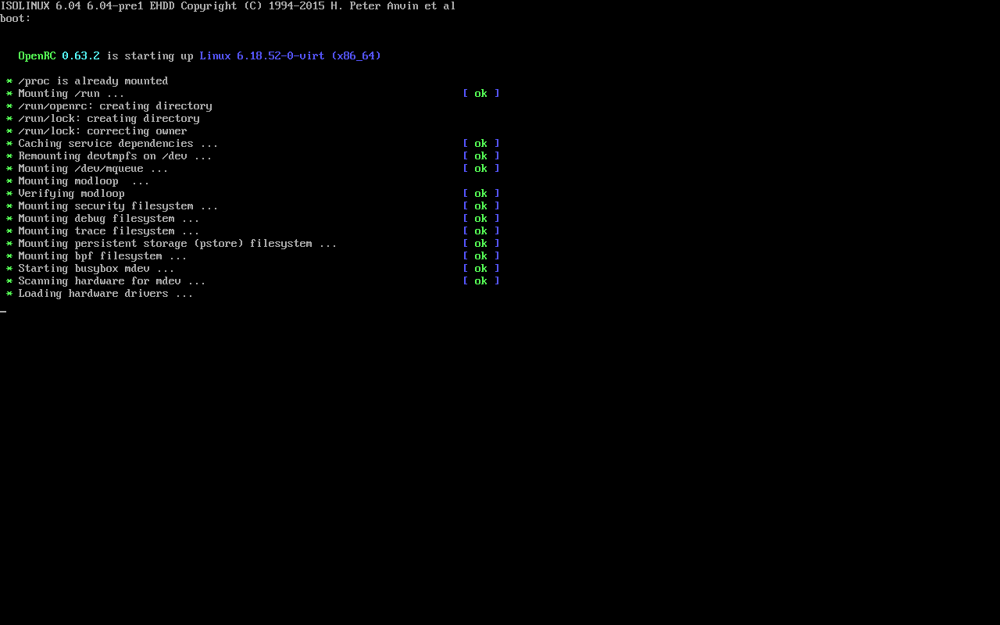

# Validation record

Initial engineering build validated 2026-10-17 on CachyOS x86_64, Rust 1.99.0, ordinary UID1000. At that stage no physical storage write, loop attachment, root GUI, privileged installation or host firmware modification was performed. The subsequent authorized installation is recorded below.

## Automated gates

The workspace uses per-command environment overrides `CARGO_TARGET_X86_64_UNKNOWN_LINUX_GNU_LINKER=/usr/bin/cc`, `CARGO_BUILD_JOBS=1`, `CARGO_PROFILE_DEV_DEBUG=0` because the inherited linker name was absent. Global configuration was not modified. Initial engineering-build gate results are in `validation-results.json`; original command logs are retained locally in ignored `test-output/`.

- `cargo fmt --all -- --check`
- `cargo clippy --workspace --all-targets -- -D warnings`
- `cargo test --workspace` (42 tests, including bounded malformed parser inputs and twelve device safety tests)
- `cargo build --release --locked`
- `python3 tests/file-integration.py --cli target/release/forgeusb`

File integration uses a new TemporaryDirectory, three 96 MiB sparse disk fixtures and system sfdisk/mkfs tools against those owned files only. Layouts: MBR/FAT32, GPT/EFI FAT32 and MBR/NTFS. Each verifies read-only planning, wrong confirmation refusal, complete write/read-back, refusal to overwrite an existing disposable output and corruption detection. A real plain ISO generated by xorriso is inspected and refused for writing. No fixtures/loop devices are reused or attached. Unit tests additionally cover cancellation mid-write, source changes, truncated extents, symlinks, capacity bounds, filesystem limits and stale GUI state. The malformed corpus is bounded deterministic testing, not a sustained coverage-guided fuzz campaign or sanitizer run.

## Boot evidence

| Image | Provenance and write | Test environment | Observed outcome |
|---|---|---|---|
| Original 1 MiB BIOS smoke disk | tests/bios-boot.S; assembled with GNU as/ld, then written by ForgeUSB into a new file and read-back verified | QEMU TCG/SeaBIOS, no network, regular disk image, isa-debug-exit | Serial `FORGEUSB_BIOS_BOOT_OK`, expected exit33; proves tiny BIOS fixture path only |
| Alpine virt 3.24.2 x86_64, 69,206,016 bytes | Official https://dl-cdn.alpinelinux.org/alpine/v3.24/releases/x86_64/alpine-virt-3.24.2-x86_64.iso; SHA256 `3ab424762af704b2c2a9e57df1dc37f982af260071504d977f2fb96822e7130b` matched official release manifest; ForgeUSB raw write/full read-back matched | QEMU TCG/SeaBIOS, USB storage device, image read-only in VM, networking disabled | Syslinux, Linux 6.18.52-0-virt and OpenRC startup reached; screenshot alpine-bios.png shows modloop verification and services. Test bounded at50s, not a completed installation |
| Same unchanged ForgeUSB-written Alpine image | Same digest/source-sized read-back | QEMU TCG/OVMF, fresh copied OVMF_VARS.4m.fd, read-only OVMF_CODE.4m.fd and USB image, no network | Initial default run reached GRUB/Linux handoff but was insufficient proof. Follow-up entered only runtime GRUB kernel command line to add `console=ttyS0,115200`; Linux/OpenRC and **localhost login** reached within55s. Serial text alpine-uefi-serial.txt and screenshot alpine-uefi.png retained |

QEMU commands attach no `/dev` host paths. They are retained in test-output/alpine-*-host/command.json and alpine-uefi-console/command.json. The test harness tests/qemu-smoke.py creates a fresh owned output/NVRAM directory, refuses nonregular/symlink images, disables networking and enforces a bounded run. QMP sockets required host execution because sandbox socket creation was denied; this was an access boundary, not an application failure. Secure Boot was not enabled, and no physical firmware acceptance is inferred. No Windows boot test was run because Windows media execution is not implemented and no authorized Windows ISO was present.

## GUI and packaging

Ordinary-user GUI launch, real SHA-256 inspection, live read-only device discovery, keyboard preview and automatic focus/scroll were exercised on an isolated Xvfb display; smoke mode forbids starting a write and no output file appeared. Main and preview screenshots were visually inspected. Physical helper was not installed and no root GUI was run. The current screenshots gui-smoke.png and gui-plan-smoke.png show the subsequent compact UI rework described below.

Desktop/SVG/Polkit XML and shell metadata were validated. The final packaging stage/source-archive results are recorded in validation-results.json. Debian/RPM recipes are untested scaffolding, not verified installable binary packages. Dependency notices collect the locked Linux target; the drm-fourcc package omits a license file upstream and that unresolved notice is explicitly recorded. This evidence supports an initial engineering build, not a production-ready release claim.

## Compact GUI rework (2026-10-17)

The current GUI follows Rufus's compact dialog hierarchy, with a light gray default, square controls, native SELECT, and a separate exact-confirmation review. Read-only DD properties remain truthful to the raw engine. [Visual QA](../design-qa.md) records the reference/state differences.

Re-ran formatting, strict workspace Clippy, all **44 tests**, and the full locked release build successfully. Current binary hashes and structured private-Xvfb results are in [ui-validation-results.json](ui-validation-results.json). The older validation-results.json hashes refer to the initial engineering build.

Release GUI tests exercised native KDE image selection, actual source inspection and read-only planning, normal device discovery without selecting a physical disk, and the 440 × 540 minimum window with advanced properties expanded. No smoke test created a target. A separate real GUI run typed the exact confirmation, wrote a newly owned 4 MiB ordinary temporary file, flushed and read back its complete source range; external CLI verification and SHA-256 comparison also passed. The screenshot showed DONE and the verified byte count. Its fixture directory was automatically removed. Zero physical writes, loop devices or privileged installations. GTK picker fallback and physical Polkit interaction were not exercised.

## Icon integration and authorized installation (2026-10-17)

The original ForgeUSB SVG is rendered into seven checked-in PNG sizes and a 64 × 64 RGBA window asset. The actual X11 window publishes `_NET_WM_ICON` and WM_CLASS `forgeusb`; Wayland uses the matching desktop app ID. The compact client layout is unchanged. Regeneration uses `bash packaging/generate-icons.sh` with librsvg/ImageMagick; normal Rust builds need neither tool.

Formatting, strict Clippy, 44 workspace tests and the locked release build pass. `tests/installation.py` stages all 17 payload files in an owned temporary directory and checks hashes, modes, PNG dimensions, existing/symlink staging refusal, changed-file uninstall refusal and complete receipt-matched removal. CI now runs these checks without elevation.

At the user's explicit request, `bash packaging/install.sh --system --no-build` installed the application, icons, license notices and narrow Polkit helper on this CachyOS machine. All 17 files matched the receipt; binaries/helper and parent directories are root-owned 0755, policy/desktop entry are 0644. Polkit reports `auth_admin` for active users and refuses inactive/other sessions. The installed GUI remains UID1000. This validates installation and policy registration, not a physical write authorization flow.

The installed CLI passed the disposable-file FAT32/NTFS, MBR/GPT, read-back, corruption and ISO-refusal integration checks. The installed GUI passed native KDE chooser → inspection → read-only plan smoke with no target creation. It was opened normally from `/usr/bin/forgeusb-gui` on the user's desktop. No physical write, loop attachment or root GUI occurred. See [installation-validation.json](installation-validation.json).

## USB discovery follow-up (2026-10-17)

Reproduced a real Kingston DataTraveler 3.0 discovery failure: SCSI serial/WWID attributes returned ENXIO despite a readable USB-device serial. Corrected the optional-attribute handling and cleared stale GUI discovery errors independently of operation errors. Four regression tests bring the workspace total to 48; formatting, strict Clippy and locked release build passed. The corrected binaries/helper were installed with the existing authorized installer and every installed hash was verified.

Live read-only enumeration finds the 61,872,793,600-byte USB as eligible while retaining system-disk refusal. A genuinely read-only physical-target plan passed, with no typed confirmation submitted or write started. The installed GUI screenshot shows one USB, READY and no automatic selection/error. Details and exact evidence limits: [USB discovery regression](usb-detection.md) and [structured results](usb-detection-validation.json). No physical writes or loop devices.

## Windows media, formatting and safety development (2026-10-17)

This pass adds the verified preparation executor described in
[Windows media](windows.md), with the final support boundary in
[production-development.md](production-development.md). It supersedes the earlier
staging-only Windows and planner-only filesystem descriptions above. The
[structured results](development-validation.json) distinguish each evidence class.

Final formatting, strict all-target workspace Clippy, **75 workspace tests** and
the locked release build passed. The unit run required all media tools; no
external-tool fixture was silently skipped.

Validation includes mandatory external-tool unit coverage (tiny genuine WIM
containers and multipart capture/split/verify/apply with original payload hashes),
ISO9660 and actual UDF extraction, MBR/GPT partition CRC/read-back, per-file FAT32
SHA-256, cancellation before publication and refusal cases. `format-image` passed
MBR/GPT × FAT32/NTFS checks, independent sfdisk metadata, full raw writes/read-back,
no-clobber, invalid geometry/label/overflow/deadline and symlink refusal.

Five original synthetic fixtures booted through actual ForgeUSB CLI preparation,
plan, write and verify: BIOS disk, Windows-shaped MBR/FAT32 UEFI, optical-ISO to
Windows-shaped GPT/FAT32 UEFI, and appended-ESP GPT ISOHybrid under BIOS and UEFI.
Expected serial markers and QEMU exit33 were required; media hashes stayed
unchanged. Tests disable networking, use read-only USB images and fresh OVMF
variables. BCD/bootmgr are explicitly synthetic placeholders; boot/install WIMs
contain ordinary test text, not Windows.

The retained 69,206,016-byte Alpine virt3.24.2 ISO (SHA-256
`3ab424762af704b2c2a9e57df1dc37f982af260071504d977f2fb96822e7130b`) was copied and
verified using the new writer, then reached **localhost login** under SeaBIOS and
OVMF. The original acquisition hash is reused; this is not a new publisher
signature validation. Real Alpine exposed an intentional ISOHybrid LBA0 GPT
partition that the initial tightened parser wrongly refused. The correction is
regression-tested while standalone GPT validation remains strict.

The actual unprivileged GUI Windows workflow prepared a private image, displayed
a review before target creation, accepted exact typed confirmation, wrote and
verified a new 320MiB ordinary file, and passed independent CLI verification.
Its private-Xvfb screenshots were inspected locally. Extra GUI tests cover mode
changes, cancellation winning over queued completion, device replacement during
preparation and source hash continuity. Existing raw GUI/native chooser smoke
and installer/source-package checks remain part of final validation.

No physical device writes, mounts, loops, root GUI, global tool installations,
large ISO downloads, remote publication or Secure Boot tests occurred. A small
official wimlib1.14.4 source archive (SHA-256
`3633db2b6c8b255eb86d3bf3df3059796bd1f08e50b8c9728c7eb66662e51300`) was built in
private temporary storage for tests; it is not bundled or globally installed.
Current real Windows Setup, physical firmware, installed-helper destructive
acceptance and native Debian/RPM package validation remain open.
